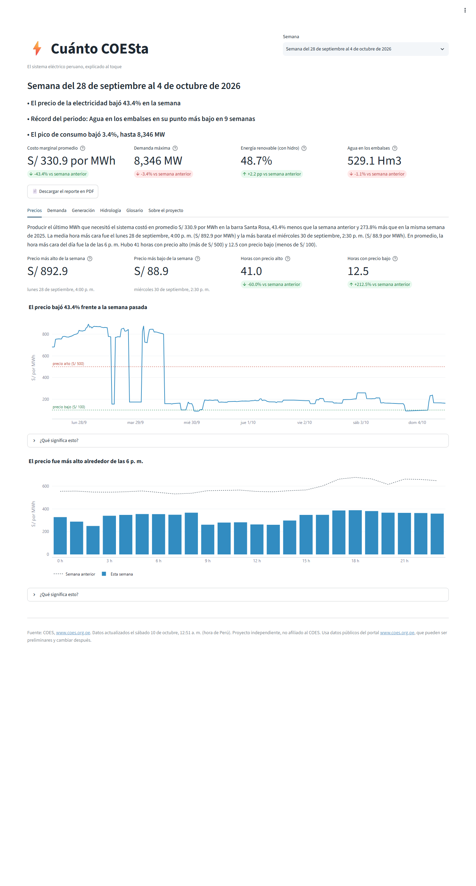
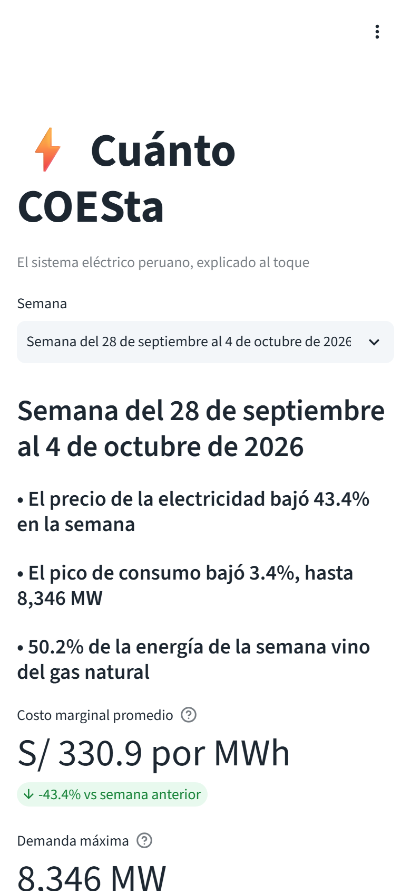
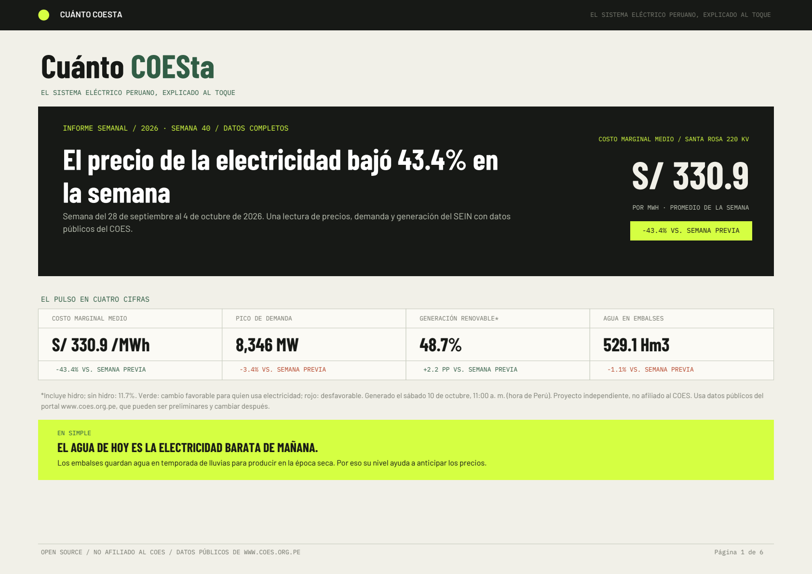

# Cuánto COESta

**El sistema eléctrico peruano, explicado al toque.**

Bot open source que cada semana descarga los datos públicos del
[COES](https://www.coes.org.pe), los ordena, calcula indicadores y los explica
en lenguaje simple en:

1. **Un dashboard** en Streamlit, con explicaciones al pasar el mouse.
2. **Un PDF semanal** de 6 páginas con cajitas de "¿Qué significa esto?" y glosario.

Pensado para todos: desde analistas del sector hasta quien nunca miró su recibo de luz con lupa.

> **Aviso.** Proyecto independiente, **no afiliado al COES**. Usa datos públicos del
> portal www.coes.org.pe, que pueden ser preliminares y cambiar después.



| Dashboard en el celular | Portada del PDF |
|---|---|
|  |  |

## Qué calcula cada semana

Todo se compara contra la semana anterior y la misma semana del año pasado.

| Tema | Indicadores |
|---|---|
| Precios | Costo marginal promedio, máximo y mínimo (barra Santa Rosa 220 kV, Lima), precio según la hora del día, horas con precio alto (más de S/ 500 por MWh) y bajo (menos de S/ 100) |
| Demanda | Demanda máxima con día y hora, energía consumida, diferencia con el programa diario del COES |
| Generación | Mix por tecnología, % renovable con y sin hidro, precio capturado por la solar y la eólica |
| Hidrología | Agua útil en los principales embalses |
| Hechos destacados | Los 3 hechos más relevantes, detectados por reglas: grandes variaciones, récords del periodo y días anómalos |

Los textos se arman con plantillas y reglas fijas (sin inteligencia artificial):
mismo dato, mismo texto, y nunca se afirma una causa que los datos no respalden.
Todas las explicaciones viven en [`config/glosario.yaml`](config/glosario.yaml).

## Cómo correrlo (3 comandos)

Requiere Python 3.11 o más nuevo.

```bash
python -m venv .venv && .venv/bin/pip install -r requirements.txt   # Windows: .venv\Scripts\pip
.venv/bin/python run_weekly.py                                      # baja, procesa y genera el PDF
.venv/bin/streamlit run app/streamlit_app.py                        # abre el dashboard
```

El PDF queda en `reports/cuanto-coesta_AAAA-Www.pdf`. Más opciones:

```bash
python run_weekly.py --semana 2026-W40     # una semana específica
python run_weekly.py --historico 8         # baja también las 8 semanas previas (para récords)
python -m src.extract --desde 2026-10-01 --hasta 2026-10-07 --fuente demanda
python -m src.transform --semana 2026-W40
python -m src.analysis --semana 2026-W40   # resumen en consola
python -m src.narrative --semana 2026-W40  # titulares y párrafos
python -m src.report --semana 2026-W40 --png
python -m pytest -q
```

## Cómo funciona

```
COES (portal + IEOD) --> src/extract --> data/raw
                         src/transform --> data/processed/*.parquet (formato largo, DuckDB)
                         src/analysis  --> ResumenSemanal (indicadores + hechos)
                         src/narrative --> titulares, párrafos, títulos de gráficos
                         src/report    --> PDF            app/ --> dashboard
```

- Fuentes y hallazgos: [`docs/fuentes_coes.md`](docs/fuentes_coes.md)
- Tablas y columnas: [`docs/diccionario_datos.md`](docs/diccionario_datos.md)
- Decisiones y estado: [`PROGRESO.md`](PROGRESO.md)

El bot es respetuoso con el servidor del COES: se identifica, espera 2 segundos
entre pedidos, guarda todo en caché y no vuelve a bajar días cerrados.

## Automatización semanal (GitHub Actions)

[`.github/workflows/semanal.yml`](.github/workflows/semanal.yml) corre cada **lunes a las
7:00 a. m. (hora de Lima)**: instala dependencias, corre `run_weekly.py` y los tests,
guarda `data/processed` en el repo (para el dashboard) y publica el PDF como
**GitHub Release** (`semana-AAAA-Www`). También se puede lanzar a mano desde la
pestaña *Actions* con una semana específica.

Si el lunes el COES todavía no publicó el informe del domingo, el reporte sale
marcado como **preliminar** en lugar de fallar.

## Desplegar el dashboard en Streamlit Community Cloud

1. Sube este repositorio a GitHub (público).
2. Corre el workflow una vez a mano (*Actions* > *Reporte semanal* > *Run workflow*)
   para que `data/processed` quede en el repo.
3. Entra a [share.streamlit.io](https://share.streamlit.io) con tu cuenta de GitHub y
   elige *Create app* > *Deploy a public app from GitHub*.
4. Completa: repositorio `tu-usuario/cuanto-coesta`, rama `main`, archivo principal
   `app/streamlit_app.py`. En *Advanced settings* elige Python 3.12.
5. *Deploy*. Cada lunes, cuando el workflow suba datos nuevos, la app se actualiza sola.

El tema visual está en `app/.streamlit/config.toml` (Streamlit lo lee junto al script).

## Cambiar el nombre

El nombre, slug y tagline viven solo en [`config/proyecto.yaml`](config/proyecto.yaml).
Cambia esas 3 líneas y todo el proyecto (dashboard, PDF, nombres de archivo) las toma de ahí.

## Licencia

[MIT](LICENSE). Los datos pertenecen a su fuente, el COES.
